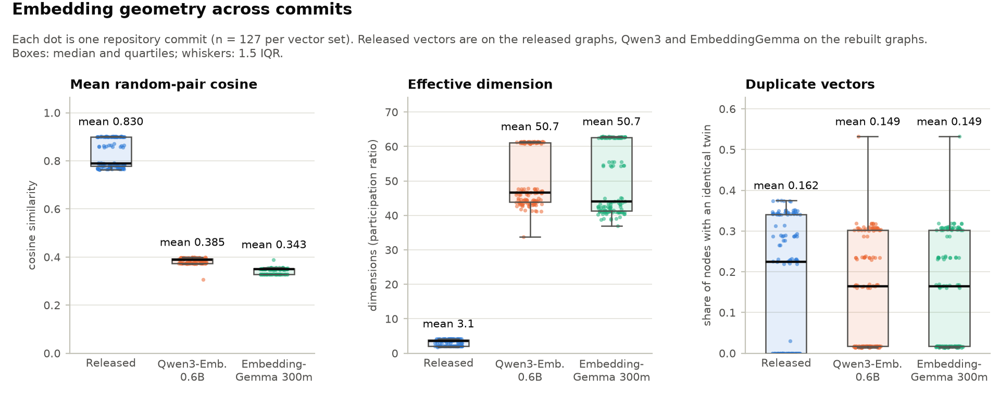
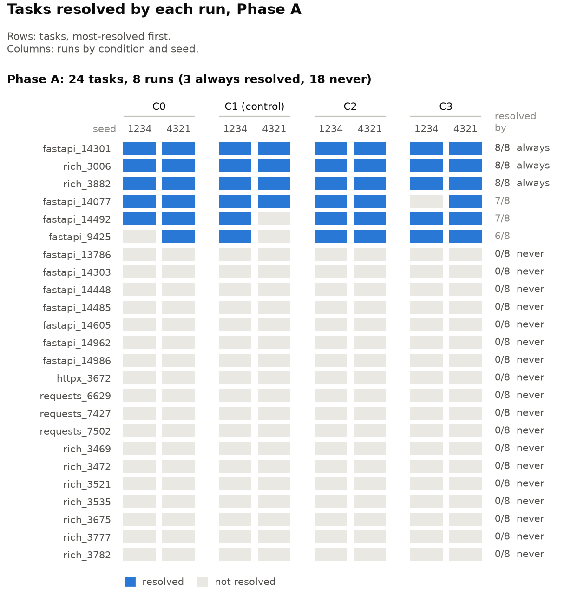
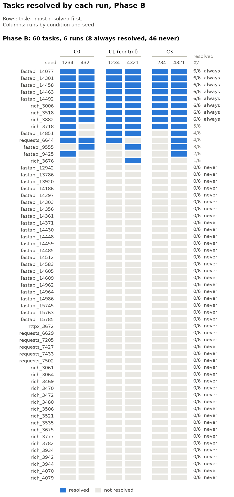
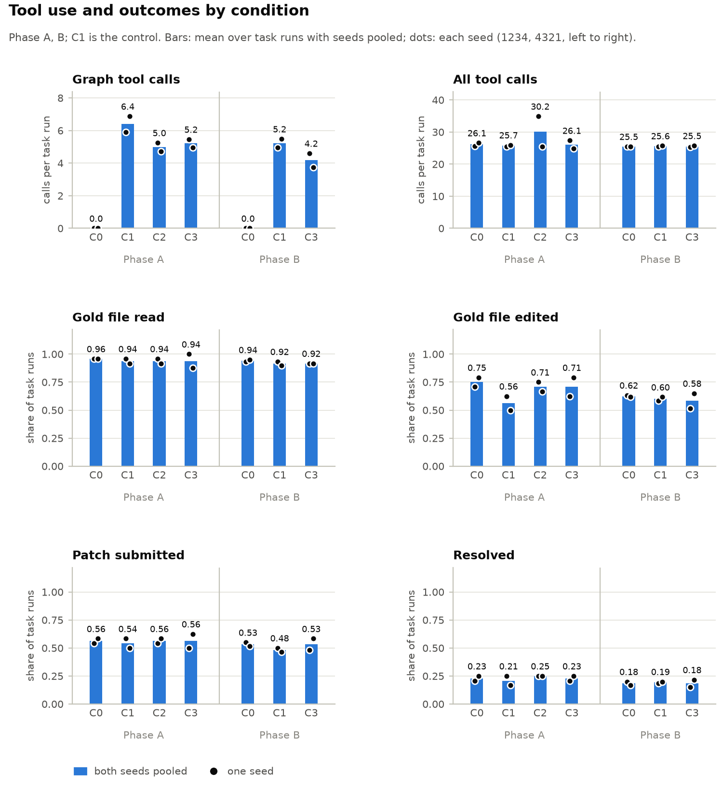

# From localization to resolution: measuring what code graphs and embeddings actually do for a local Gemma 4 coding agent

**Subtitle:** A pre-registered, seed-replicated ablation inside the official Gemma 4 Developer Agent harness, plus a kit for swapping graph and embedding bundles.

<!-- Criteria: Novelty 1, 4.2, 4.3, 7; Quality 3, 4.1; Relevance 1, 2; Verifiability 3, 6; Clarity 2. Sources: paper/sources.md. -->

## Abstract

<!-- paper/sources.md#abstract -->
Code graphs and embeddings are a common aid for small local models navigating repositories. The Gemma 4 Developer Agent competition ships both; two public audits found defects, but as far as public pages show, none measured whether better inputs fix more bugs. We run the agent end to end in the official harness with Gemma 4 31B, varying only these inputs over two seeds and judging effects against a pre-registered noise floor. On 24 tasks the control's seeds disagree on 2. Replacing the analyzer's graph tools with grep changes pooled resolution by +0.021 (McNemar p 1.000), inside that floor. Regenerated embeddings change nearly every embedding-based search result yet move resolution by +0.042 (p 0.500). Rebuilt graphs with their own embeddings move it by +0.021 (p 1.000). No condition clears the floor. On 60 confirmation tasks (control seeds disagree on 3), rebuilt graphs move resolution by -0.008 (p 1.000), inside its noise floor. The grep analyzer also moves it by -0.008 (p 1.000); as in Phase A, neither clears the floor. We release graphswap, a kit and bundles for swapping harness inputs.

## 1. Introduction

<!-- paper/sources.md#1 -->
Local coding agents work under hard limits: in our runs, 8 minutes per task and a 31B model on four L4 GPUs. The competition ships a code graph and node embeddings per repository snapshot, for three harness tools.

Public projects have audited or rebuilt these inputs [1-4]. Two report defects: no async definitions [2, 4], only `calls` edges [4], and collapsed or duplicated vectors [2, 4]. All four center on localization; as far as their public pages show, none varies the graph inputs and counts resolved tasks. One ran the agent end to end; an identical rerun changed outcome on 8 of 30 tasks [4], so single runs cannot settle effects of a few tasks.

We ask whether graph or embedding quality changes how many bugs get fixed under real budgets.

We contribute a pre-registered, seed-replicated, end-to-end ablation with a measured noise floor, and the `graphswap` kit and bundles.

## 2. Background: what the harness lets a graph do

<!-- paper/sources.md#2 -->
The harness, swegemma 0.2.11 [19], supplies sandbox, budgets, tools and test-based scoring. Our root coder holds `read_file`, `run_command`, `edit_file`, `write_file`, `get_status` and `submit_patch`, and delegates to a read-only `code_analyzer` sub-agent. Officially the analyzer holds `read_file` and three graph tools: `get_code_neighbors` and `get_code_subgraph` walk edges from a named node, and `search_similar_code` ranks nodes by embedding similarity. Conditions change only the analyzer's tools, so the root coder can grep everywhere.

Three details bound what better inputs can change. `search_similar_code` cannot embed free text offline: a query that does not resolve to a node name falls back to lexical token overlap, so embeddings matter only for node-to-node similarity. Names resolve in four tiers (exact, suffix, case-insensitive, substring), so graph ids must be dotted paths the agent can guess from source. Each tool call returns at most 5,000 characters.

The competition's 127 embedding sets, one per base commit (Fig. 1), have mean random-pair cosine 0.830, mean effective dimension 3.138 (participation ratio of the covariance spectrum) and duplicate rate 0.162 (share of nodes with a byte-identical vector twin). Released graphs hold on average 0.931 of gold symbols (innermost definitions enclosing lines the reference patch edits) over 121 tasks and 0.855 over the 22 Phase A tasks (Section 3.4) with a gold symbol; rebuilt graphs cover 1.000 by construction.

*Figure 1. Embedding geometry over 127 commits. Released effective dimension ranges from 1.726 to 4.224; both regenerated sets average 50.7.*

## 3. Method

<!-- paper/sources.md#3 -->
### 3.1 Conditions

Only C0 and C1 (Table 1) are scorer-legal: the competition scorer applies the same harness and caps with its own graphs; C2 to C4 change harness data or code.

| id | analyzer tools | graphs | embeddings | isolates |
|---|---|---|---|---|
| C0 | `read_file`, `run_command` | none | none | graph tooling |
| C1 | 3 graph tools, `read_file` | released | released | control |
| C2 | as C1 | released | regenerated, released nodes | embedding quality |
| C3 | as C1 | rebuilt | regenerated, rebuilt nodes | graph structure |
| C4 | as C1, plus free-text query embedding | rebuilt | regenerated | tool ceiling |

C0 and C1 differ in two ways by design: C0 is the strongest non-graph analyzer we can give the agent (grep through `run_command`), not C1 minus the graph tools.

### 3.2 Bundles

The `graphswap` builder (Python `ast`) emits modules, classes, functions, async functions and methods in the released dotted-path id convention; on average 0.878 of released node ids exist in the rebuilt graph. Released graphs carry one edge type, `calls`, a symmetric union of containment, inheritance and calls. Rebuilt graphs keep four typed, directed kinds (`calls`, `contains`, `imports`, `inherits`), unfiltered, by a ruling made before Phase A. Embeddings use Qwen3-Embedding-0.6B [17] (1024 input tokens, 1024-d). C2 embeds the released graphs' own node texts, so only the vectors change. EmbeddingGemma-300m [18] vectors for the rebuilt graphs, added by dated amendment, are an offline comparison only (Fig. 1).

### 3.3 Agent, hardware, budgets

The agent is our main-track submission, a tool-using loop like SWE-agent [10], not a pipeline like Agentless [11], on adk-submission 0.2.13 and google-adk 1.36.1. vLLM 0.19.1 serves Kaggle model `google/gemma-4/other/gemma-4-31b-it-qat-w4a16-ct` (version 2) [16] over four L4 GPUs (tensor parallel, `max_model_len` 32,768). Budgets: 8 minutes per task, 28 harness tool calls shared by root coder and analyzer (`submit_patch` and `get_status` exempt), 240 s per command, 200 turns. Sampling: temperature 0.2, top_p 0.95, 16,384 output tokens, 4,096-token thinking budget, four tasks in parallel, seeds 1234 and 4321. The analyzer prompt is tool-agnostic and byte-identical across conditions; run manifests record condition and bundle hashes, and mismatches are refused.

### 3.4 Task sets, replication, statistics

Tasks are SWE-bench-style [8, 9]. Phase A uses 24 tasks drawn with seed 0, stratified by repository (fastapi 11, rich 9, requests 3, httpx 1). Phase B's 60 tasks, also drawn with seed 0, contain all 24 (fastapi 31, rich 22, requests 6, httpx 1). A task is resolved when swegemma's test evaluation marks the submitted patch resolved, as on the competition scorer.

The primary metric is resolution rate, paired per task against C1 at the same seed. Pooling seeds, we report the exact McNemar test [12], known to be conservative [13], and a task-resampling 95% bootstrap interval (10,000 resamples, seed 0), since a task's two seeds are correlated [14, 15]. The noise floor is the number of tasks where C1's seeds disagree. An effect is beyond noise only if p < 0.05 and |wins - losses| exceeds the floor. Phase B runs the two conditions with the largest pooled |diff| against C1, or C0 and C3 if none clears the floor. No run is discarded, and the experiment ledger (`docs/experiments.md`) counts context-window overflows as unresolved.

The pre-registration, `docs/preregistration.md` (sha256 `83cda15eb084d9d6462096977e6a295c1a9c6d7d9970bf595a6604d65f24e92b`), lists both task sets and is unchanged since a clarification made before the first Phase A run. Its hash and that of `eval/subset60.txt` sit in `docs/preregistration.sha256`, whose OpenTimestamps proof (`.ots`) has its earliest Bitcoin attestation in block 973351 (2026-10-27 05:26 UTC). That dates the pre-registration before any Phase B treatment run (C0, C3), not before Phase A or the Phase B controls, which ran earlier. A dated amendment adds same-seed C1 controls to Phase B.

## 4. Results

<!-- paper/sources.md#4 -->
### 4.1 Noise floor

C1 resolved 6 of 24 tasks at seed 1234 and 4 at seed 4321. The seeds disagree on 2 tasks, fastapi_14492 and fastapi_9425, both solved only at 1234 (McNemar p 0.500, 95% CI [-0.208, 0.000]). The smallest effect the rule can then declare is 6 discordant pairs in one direction, a pooled |diff| of at least 0.125. Phase B's floor of 3 (Section 4.5) does not raise the 6-pair minimum, because p < 0.05 binds first. Outcomes are stable: across all eight Phase A runs, 3 tasks were always resolved, 18 never, and only 3 ever changed outcome (Fig. 2).

### 4.2 Does any graph tooling help? (C0 vs C1)

Pooled over 48 task-seed pairs in 24 task clusters, C0 resolved 0.229 and C1 0.208 (diff +0.021; wins 2, losses 1; McNemar p 1.000; clustered 95% CI [0.000, 0.063]), not beyond noise. The seeds disagree in direction: C0 lost fastapi_9425 at seed 1234 and won fastapi_14492 and fastapi_9425 at seed 4321, all noise-floor tasks.

Only fastapi_14492 differs net at task level, so the interval's zero lower bound reflects one informative cluster. The pooled McNemar test treats the 48 rows as independent.

*Figure 2. Tasks resolved in each Phase A run; only fastapi_9425, fastapi_14492 and fastapi_14077 vary.*

### 4.3 Do better embeddings help? (C2 vs C1)

C2 resolved 0.250 against 0.208 (+0.042; wins 2, losses 0; p 0.500; CI [0.000, 0.104]), not beyond noise. At seed 1234 it resolved exactly C1's tasks; both wins are seed-4321 noise-floor tasks.

The swap was real. Of each run's searches, 0.615 to 0.645 resolved to a node (the embedding path). Of those, 0.187 to 0.288 resolved by substring, to the shallowest matching node, intended or not. Replayed under both vector sets, result lists shared 0.126 to 0.158 of entries, kept the top hit in 0.080 to 0.136 and were identical in 0.035 to 0.051. Released vectors reproduce 60/61 and 71/74 C1 lists, regenerated ones 56/58 and 47/51 C2 lists.

### 4.4 Do better graphs help? (C3 vs C1, C3 vs C2)

C3 resolved 0.229 against 0.208 (+0.021; wins 2, losses 1; p 1.000; CI [-0.042, 0.083]), not beyond noise. It won the two noise-floor tasks at seed 4321 and lost fastapi_14077 at seed 1234 with a patch that failed evaluation; every other Phase A run resolved that task. In an exploratory, not pre-registered comparison with C2 (same embedding model, released graphs), C3 resolved 0.229 against 0.250 (-0.021; wins 0, losses 1, again fastapi_14077; p 1.000; CI [-0.063, 0.000]). The rebuilt graphs' full gold coverage (Section 2) bought no detectable gain.

**Phase A outcome.** No condition beats C1 beyond noise. Only C1 at seed 4321 missed both fastapi_14492 and fastapi_9425. Each treatment's two wins at that seed, the source of every positive pooled difference, reflect the control's own seed variance. Four of 192 task attempts overflowed the 32,768-token window and count as unresolved; no run solved those tasks. The pre-registered rule sends C0 and C3 to Phase B, with C1. C4 (run only if C3 beats C1 beyond noise) and EmbeddingGemma (only if C2 does) do not run.

### 4.5 Phase B confirmation on 60 tasks

Phase B runs C1, C0 and C3 at both seeds on the 60 pre-registered tasks (`eval/subset60.txt`). The control resolved 11 and 12 of 60 at seeds 1234 and 4321 (0.183, 0.200) and its seeds disagree on 3 tasks (p 1.000; CI [-0.033, 0.067]), so an effect needs pooled p < 0.05 and |wins - losses| > 3 (smallest: 6-0, |diff| 0.050).

Pooled over 120 task-seed pairs in 60 task clusters, C3 resolved 0.183 and C1 0.192 (diff -0.008; wins 2, losses 3; McNemar p 1.000; clustered 95% CI [-0.033, 0.017]), not beyond noise; the seeds split 0-2 at 1234 and 2-1 at 4321. One loss, fastapi_14851 at seed 1234, is a context-window overrun counted as unresolved (Section 3.4); both control runs resolved it. The other discordant pairs fall on seed-sensitive tasks (Fig. 3): requests_6644 and rich_3676 (Phase B floor) and fastapi_9425 (Phase A floor). For C3, Phase B agrees with Phase A: no detectable change.

Pooled the same way, C0 resolved 0.183 and C1 0.192 (diff -0.008; wins 2, losses 3; McNemar p 1.000; clustered 95% CI [-0.042, 0.025]), not beyond noise, agreeing with Phase A; the seeds split 1-0 at 1234 and 1-3 at 4321. Its discordant tasks are C3's plus rich_3718, which every other Phase B run resolved; none overran.

Over all six Phase B runs, 46 tasks were never resolved, 8 always, and 6 changed outcome. Context-window overruns hit 10 of 360 Phase B attempts and 4 of 192 in Phase A (Fisher exact p 0.78); pooled, 14 of 552 (2.5%).

*Figure 3. Tasks resolved in each Phase B run.*

### 4.6 Mechanism: what the agent did differently

In Phase A, pooling seeds (Fig. 4), C1, C2 and C3 made 6.396, 4.979 and 5.208 graph-tool calls per task run, with one error response (C2, seed 1234). Like C1 and C2, C3 sent most searches down the embedding path (0.636 and 0.604), but fewer of those through the substring tier (0.100 and 0.121). Logged tool calls (including exempt, delegation and rejected calls) averaged 25.708 to 26.146, except in C2 (30.188). There one seed-1234 task, fastapi_14077, logged 199 calls and 1,837,528 prompt tokens. Every condition read a gold file (one the reference patch edits) in at least 0.938 of task runs. Prompt tokens per task run were 172,505 (C0), 200,760 (C1), 236,850 (C2, including that task) and 203,848 (C3). C1 edited a gold file least often (0.563, against 0.708 to 0.750). These gaps are descriptive, not pre-registered tests.

*Figure 4. Tool use and outcomes in Phase A (C0 to C3) and Phase B (C0, C1, C3); bars pool seeds, dots are seeds. One task drives C2's high seed-1234 dot in All tool calls.*

## 5. Discussion

<!-- paper/sources.md#5 -->
Three measured facts, none pre-registered, bear on the null result. First, the varied inputs touch a small share of the work: in Phase B, C1 made 5.217 graph-tool calls per task run among 25.592 logged calls, C3 4.175 among 25.517, about one in five or six; C0, without graph tools, still read a gold file in 0.958 of Phase A task runs. Second, the 8-minute session ends far more tasks than the call budget: 7 to 12 timeouts against 0 to 2 budget stops per Phase A run, 23 to 28 against 1 or 2 per Phase B run of C1 or C3, though 20 to 30 tasks per such run also used all 28 calls. Third, a floor effect: 18 of 24 Phase A tasks were never resolved, and neither control seed resolved 47 of 60 Phase B tasks. Inputs might matter under looser budgets, to an agent that leans on them more, or on tasks nearer the solve boundary; we tested none.

## 6. Resource: graphswap

<!-- paper/sources.md#6 -->
`graphswap` (Apache-2.0) is a command-line kit that builds harness-compatible graphs from public upstream checkouts, embeds them with any sentence-transformers model, writes per-file and bundle SHA-256 hashes, and produces audits, per-task CSVs, comparisons and task sets. Any node-link graph with `id`, `name` and `text` nodes loads unchanged.

| bundle (condition) | bundle_sha |
|---|---|
| emb_released_nodes (C2) | `1ab74f38a99b5f5341d06f9ffa7c5c47d2aeb610427cbadc27007e08768ace76` |
| graphs_rebuilt (graphs only) | `c94423f07688cd45aa5ddab8841279b3433a6268607664baf6a6682a08ec670e` |
| rebuilt_full (C3) | `c6e0913dabd920f737d92440f0cf4b7bac26e6562625a01c875d900311aa17b2` |

The public Kaggle dataset https://www.kaggle.com/datasets/ibrahimkhalil09/gemma4-graphswap-bundles holds `rebuilt_full` (graphs, embeddings, hash `MANIFEST.json`); check it against the table. `emb_released_nodes` derives from the competition's released node texts, so it is unpublished; the kit regenerates it from an entrant's copy. Its `bundle_sha` hashes raw float32 bytes, so it can match only on our device class, Apple MPS. Off MPS we re-embedded only rebuilt nodes (same encoder and code path): on CPU in bfloat16, the smallest rebuilt graph (httpx at 4acf5c2, 885 nodes) gave per-node cosine to our MPS vectors of min 0.999728, median 0.999851, none byte-identical.

The repository (https://github.com/m-ibrahim-khalil/gemma4-graphswap, tag `v1.0`) holds the kit, per-task CSVs, summary tables, figures, `harness-tooling/` and `kaggle/analysis_notebook.ipynb`, which runs on Kaggle at https://www.kaggle.com/code/ibrahimkhalil09/gemma4-graphswap-analysis. It omits swegemma source, task text, released graphs and embeddings, and raw traces, which embed task text. It is a single squashed commit because the development history contained test fixtures derived from competition traces; per-task results, the pre-registration and its timestamp are included.

## 7. Related work

<!-- paper/sources.md#7 -->
SWE-GraphBench audits the released graphs, rebuilds all 127 and benchmarks LLM-free localization [1]. danielmantiglia's codegraph-loc adds an async-aware generator and a pre-registered Gemma 4 localization agent scored by Hit@5 [2]; Benadict-Git's codegraph-loc builds tree-sitter graphs and a SWE-bench Lite localization agent [3]. gemma4-code-graph-localization finds grep and BM25 beat the graph and embedding tools on file-level hit@5 [4].

RepoGraph adds a repository graph to four SWE-bench frameworks, reporting resolve-rate gains of 2.00 to 2.66 points on SWE-bench Lite without variance [5]. CodexGraph gives agents a code graph database [6]; LocAgent navigates a heterogeneous code graph, reaching up to 92.7% file-level localization accuracy [7]. They change agent and harness; we vary only the data.

## References

Accessed 2026-10-24.

1. natemeton-hub. SWE-GraphBench. https://github.com/natemeton-hub/swe-graphbench
2. danielmantiglia. codegraph-loc. https://github.com/danielmantiglia/codegraph-loc
3. Benadict-Git. codegraph-loc. https://github.com/Benadict-Git/codegraph-loc
4. aghasalim. gemma4-code-graph-localization. https://github.com/aghasalim/gemma4-code-graph-localization
5. Ouyang et al. 2025. RepoGraph: Enhancing AI Software Engineering with Repository-level Code Graph. ICLR. https://arxiv.org/abs/2410.14684
6. Liu et al. 2024. CodexGraph: Bridging Large Language Models and Code Repositories via Code Graph Databases. https://arxiv.org/abs/2408.03910
7. Chen et al. 2025. LocAgent: Graph-Guided LLM Agents for Code Localization. https://arxiv.org/abs/2503.09089
8. Jimenez et al. 2024. SWE-bench: Can Language Models Resolve Real-World GitHub Issues? ICLR. https://arxiv.org/abs/2310.06770
9. princeton-nlp. SWE-bench Verified. https://huggingface.co/datasets/princeton-nlp/SWE-bench_Verified
10. Yang et al. 2024. SWE-agent: Agent-Computer Interfaces Enable Automated Software Engineering. https://arxiv.org/abs/2405.15793
11. Xia et al. 2024. Agentless: Demystifying LLM-based Software Engineering Agents. https://arxiv.org/abs/2407.01489
12. McNemar 1947. Note on the Sampling Error of the Difference Between Correlated Proportions or Percentages. https://doi.org/10.1007/BF02295996
13. Fagerland et al. 2013. The McNemar test for binary matched-pairs data: mid-p and asymptotic are better than exact conditional. https://doi.org/10.1186/1471-2288-13-91
14. Field and Welsh 2007. Bootstrapping Clustered Data. https://doi.org/10.1111/j.1467-9868.2007.00593.x
15. Miller 2024. Adding Error Bars to Evals: A Statistical Approach to Language Model Evaluations. https://arxiv.org/abs/2411.00640
16. Gemma Team 2026. Gemma 4 Technical Report. https://arxiv.org/abs/2607.02770
17. Qwen. Qwen3-Embedding-0.6B. https://huggingface.co/Qwen/Qwen3-Embedding-0.6B
18. Google. EmbeddingGemma-300m. https://huggingface.co/google/embeddinggemma-300m
19. Google, Kaggle. Google: The Gemma 4 Developer Agent Paper Track. https://www.kaggle.com/competitions/gemma-4-developer-agent-paper

<!-- Links to attach on Kaggle: public analysis notebook; GitHub repo (Apache-2.0) with release `v1.0`; arXiv-ready PDF (optional). -->
